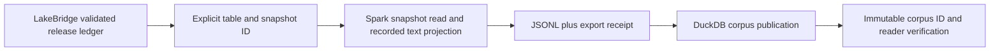

# LakeBridge corpus publication extension

LakeBridge already owns validated release selection and Iceberg snapshot retention. This adapter consumes those public release pointers. It does not rewrite Iceberg metadata, change the upstream release ledger, or create another transactional lakehouse.



The boundary is a durable export directory containing `source.jsonl` and `receipt.json`. This permits LakeBridge's Python 3.11 / PyArrow 19 / Spark 3.5 runtime and the publisher's Python 3.14 / PyArrow 25 / DuckDB 1.5 runtime to remain separately pinned. No dependency override in the original LakeBridge environment is required.

`export_release` obtains an explicitly named validated release through `Control.release`, reads the selected table with Spark's `snapshot-id` option, and records ID columns, text columns, tombstone filtering, projected row count, release content hash, source hash and upstream code hashes. The integration uses a read-only Control connection. Projected IDs must be unique and nonnull. The JSONL is sorted by the projected ID. Receipts contain the entire upstream release record, including snapshot pointers, and become part of the corpus manifest's identity.

`publish_export` checks the receipt and exported source before handing it to the deterministic corpus publisher. It binds the supplied receipt, not an authenticated remote attestation. The production caller remains responsible for receiving the receipt from its trusted LakeBridge export runtime and retaining the referenced upstream snapshots long enough to repeat extraction. Once published, the corpus release keeps its own source copy and can be consumed independently.

## Actual qualification

`scripts/qualify_lakebridge_upstream.py` creates a fresh local synthetic LakeBridge dataset, executes a real initial migration/publication, exports the published detail snapshot, executes a later source revision, and exports both the old and new snapshots. It verifies that the old snapshot's content is unchanged after the later publication and that export did not modify control state. These are newly run Spark/Iceberg operations, not historical records relabeled as current tests.

The DuckDB side then publishes all three exports. Initial and repeated-old exports have equal corpus IDs; the later export has a distinct ID. The old release contains 100 projected live records; the later release has 99. The version diff reports 4 added, 5 removed and 95 unchanged normalized texts. Independent sample/audit/source reconciliation passes for both versions. See `evidence/lakebridge-integration.json` and its portable raw bundle.

## Reproduction

From the A repository, with LakeBridge checked out and its documented pinned environment/bootstrap completed:

```bash
LAKEBRIDGE_JARS=/path/to/LakeBridge/.runtime/jars \
  /path/to/LakeBridge/.venv/bin/python scripts/qualify_lakebridge_upstream.py \
  --lakebridge /path/to/LakeBridge --work .run/lakebridge-qualified
.venv/bin/corpus-release publish-export .run/lakebridge-qualified/export-first .run/corpus --license CC0-1.0
.venv/bin/corpus-release publish-export .run/lakebridge-qualified/export-later .run/corpus --license CC0-1.0
.venv/bin/corpus-release reconcile .run/corpus
```

The qualification requires a fresh `--work` path and local JVM/socket permission. It writes its catalog, Spark event logs and sources there. The synthetic JSON projection demonstrates provenance and snapshot semantics; it does not establish natural training-text quality or GPU feeding rate.
